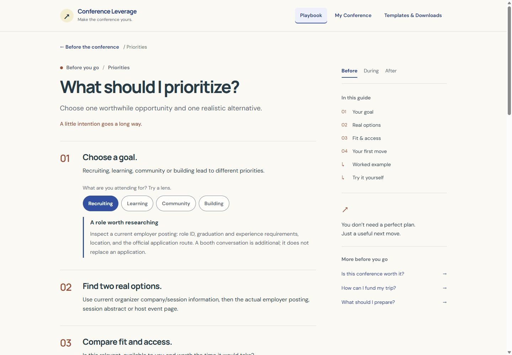
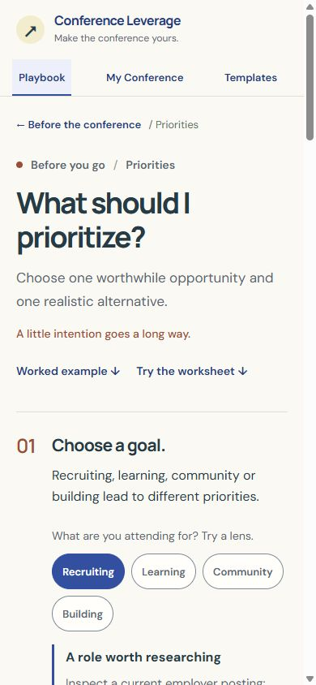
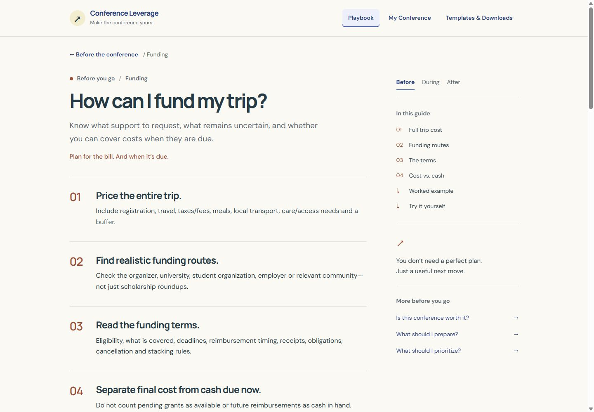
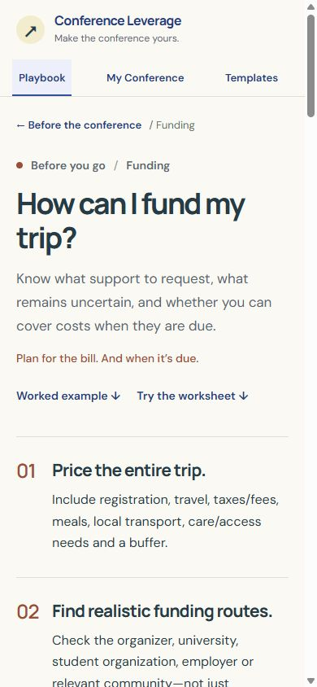
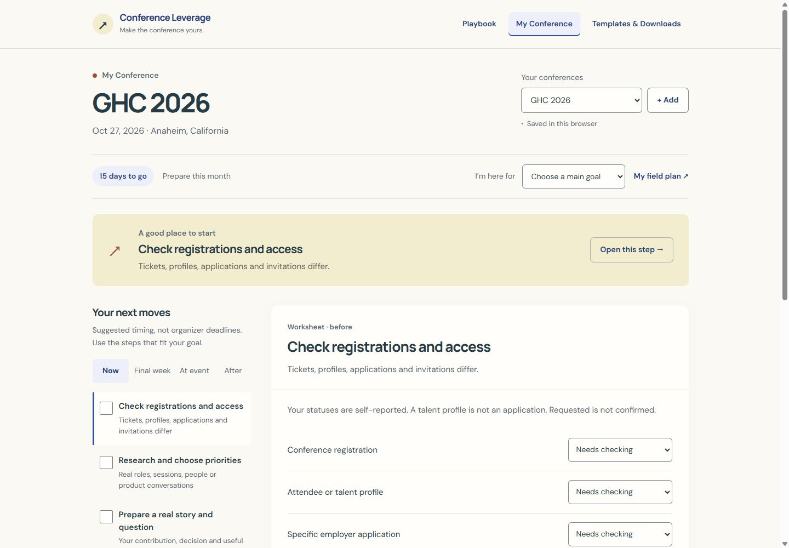
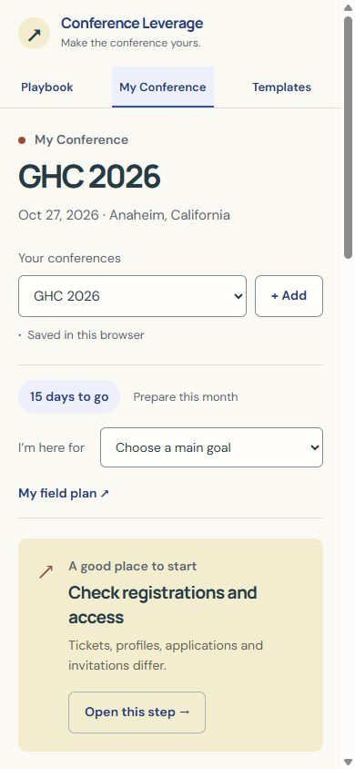
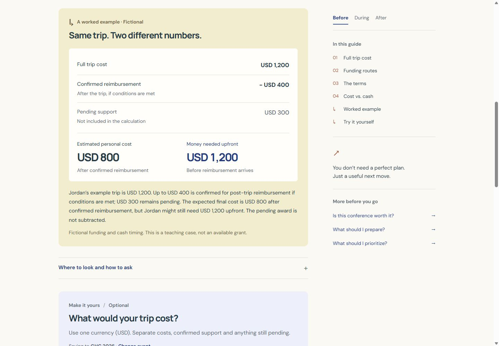
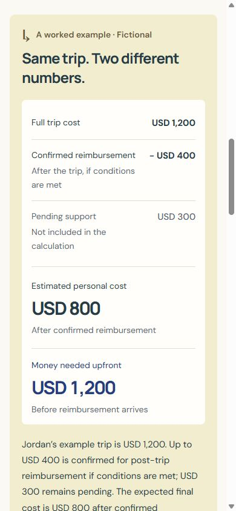
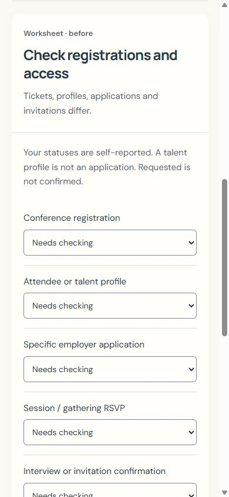

# Conference Leverage · three-experience design review

Internal review, October 12, 2026. These are actual Chromium screenshots of the original v5 prototype and the implementation on this branch. No deployment or full-site design rollout is included.

The matched views use 1,440 × 1,000 px desktop and 390 × 844 px mobile rendering areas. They show the same guide routes and a neutral GHC planning checklist. Fictional funding figures and appointments were used separately for functional QA; no actual opportunity or access is confirmed by this work.

Serve [the interactive comparison gallery](review.html) to switch between desktop and phone pairs. [The responsive preview](viewport.html) renders the actual app at six selectable widths. [Design tokens/patterns](../docs/DESIGN_SYSTEM.md) and [QA results/limitations](../docs/DESIGN_QA.md) explain what changed and what remains.

## What should I prioritize?

Open numbered advice, a goal-sensitive explanation, a fictional comparison, optional exact research steps and an integrated priority form. The approved checks/example/instructions remain in the renderer.

| Desktop · before | Desktop · after |
| --- | --- |
|  |  |

| Mobile · before | Mobile · after |
| --- | --- |
|  |  |

## How can I fund my trip?

The same reading system with an explicit full-cost/confirmed/pending ledger, separate final and upfront amounts, and a shared live worksheet. Pending support is not subtracted.

| Desktop · before | Desktop · after |
| --- | --- |
|  |  |

| Mobile · before | Mobile · after |
| --- | --- |
|  |  |

## My Conference

A clear suggested next action, shared typography/controls, an open desktop task rail and a compact mobile disclosure. Existing event separation, access states, templates, appointments, print and privacy behavior remain.

| Desktop · before | Desktop · after |
| --- | --- |
|  |  |

| Mobile · before | Mobile · after |
| --- | --- |
|  |  |

## Examples and tools in context

| Mobile funding example | Mobile planner editor |
| --- | --- |
|  |  |

## Review focus

Assess the typography, paper/blue/butter palette, reading rhythm and connection between the guides and planner. These are three representative experiences; the remaining guide bodies and legacy screens have not received this design pass. Workbook assets, full assistive-technology/print QA and launch-time source freshness still prevent production approval.
