# Conference Leverage · three-experience design review

Initial review, October 12, 2026. These are actual Chromium screenshots of the original v5 prototype and the first implementation on this branch. The after captures use the selected Charcoal & teal palette. The subsequent authorized rollout is documented in [the full rollout review](ROLLOUT_REVIEW.md) and [interactive gallery](rollout-review.html).

The matched views use 1,440 × 1,000 px desktop and 390 × 844 px mobile rendering areas. They show the same guide routes and a neutral GHC planning checklist. Fictional funding figures and appointments were used separately for functional QA; no actual opportunity or access is confirmed by this work.

Serve [the interactive comparison gallery](review.html) to switch between desktop and phone pairs. [The responsive preview](viewport.html) renders the actual app at six selectable widths. [Design tokens/patterns](../docs/DESIGN_SYSTEM.md) and [QA results/limitations](../docs/DESIGN_QA.md) explain what changed and what remains.

## What should I prioritize?

Open numbered advice, a goal-sensitive explanation, a fictional comparison, optional exact research steps and an integrated priority form. The approved checks/example/instructions remain in the renderer.

| Desktop · before | Desktop · after |
| --- | --- |
| 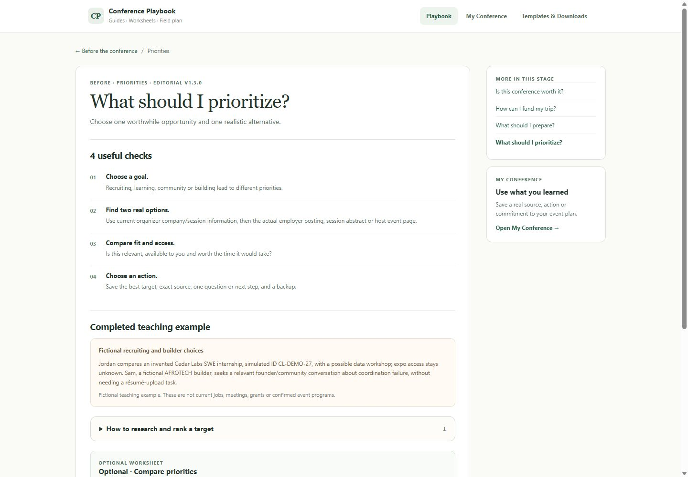 | 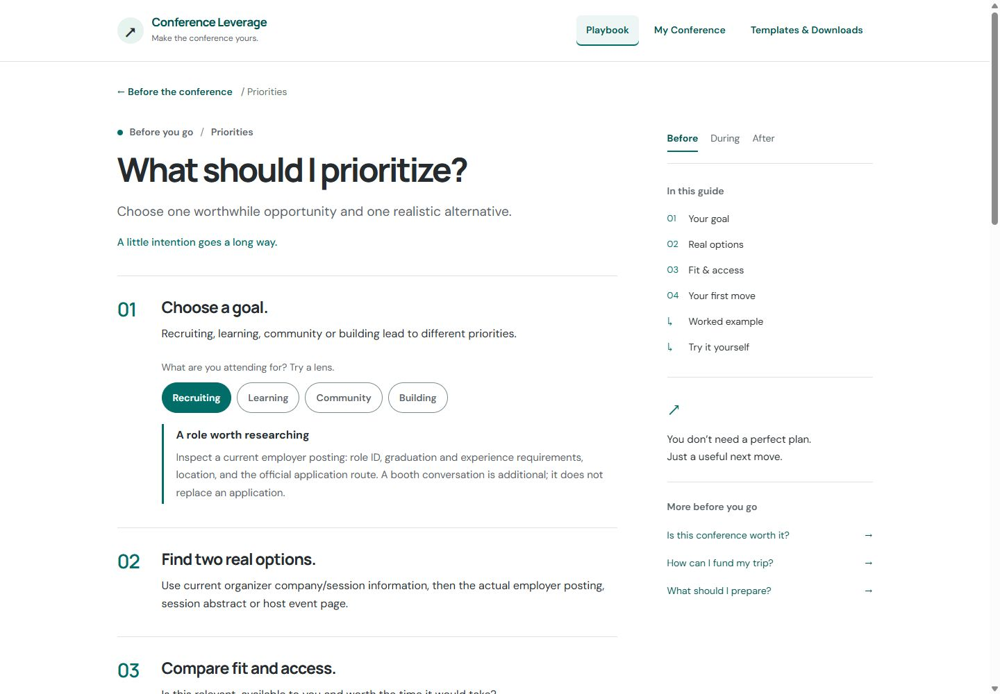 |

| Mobile · before | Mobile · after |
| --- | --- |
| 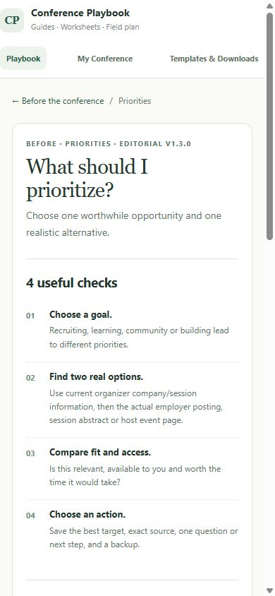 | 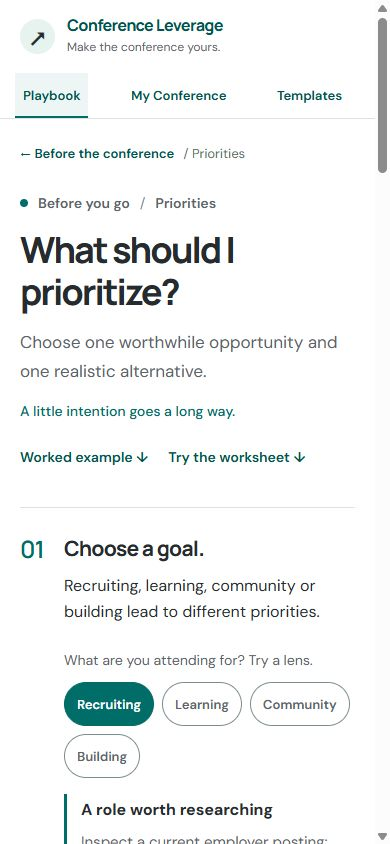 |

## How can I fund my trip?

The same reading system with an explicit full-cost/confirmed/pending ledger, separate final and upfront amounts, and a shared live worksheet. Pending support is not subtracted.

| Desktop · before | Desktop · after |
| --- | --- |
| 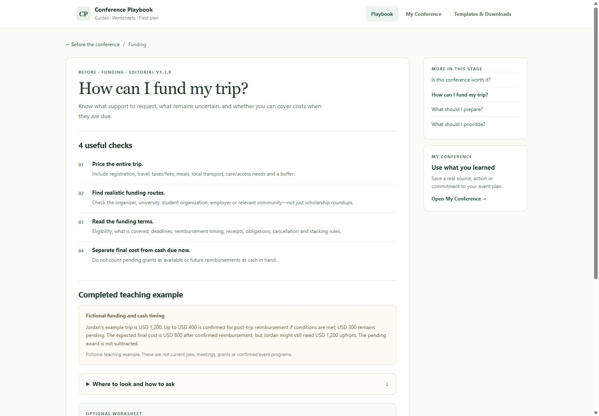 | 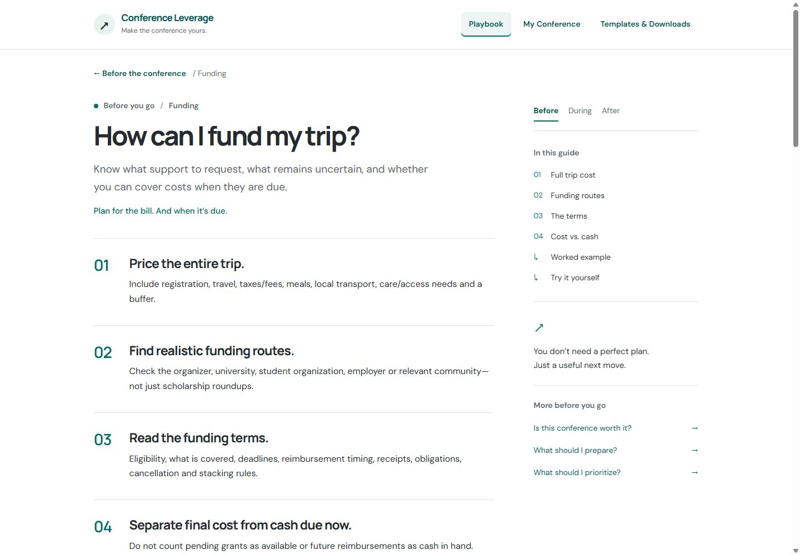 |

| Mobile · before | Mobile · after |
| --- | --- |
| 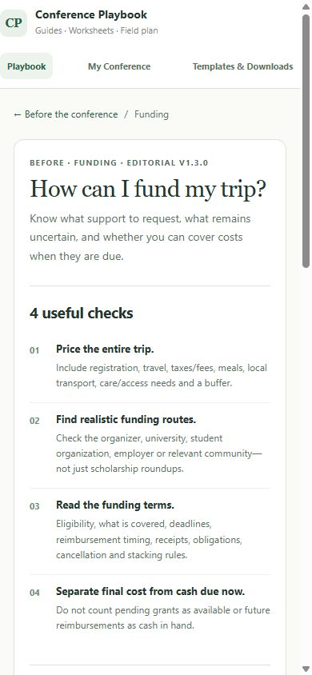 | 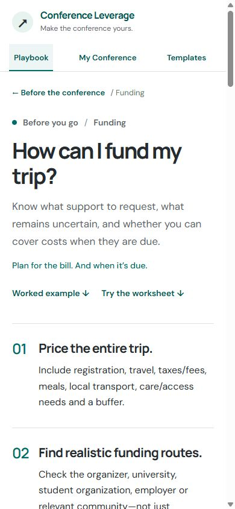 |

## My Conference

A clear suggested next action, shared typography/controls, an open desktop task rail and a compact mobile disclosure. Existing event separation, access states, templates, appointments, print and privacy behavior remain.

| Desktop · before | Desktop · after |
| --- | --- |
| 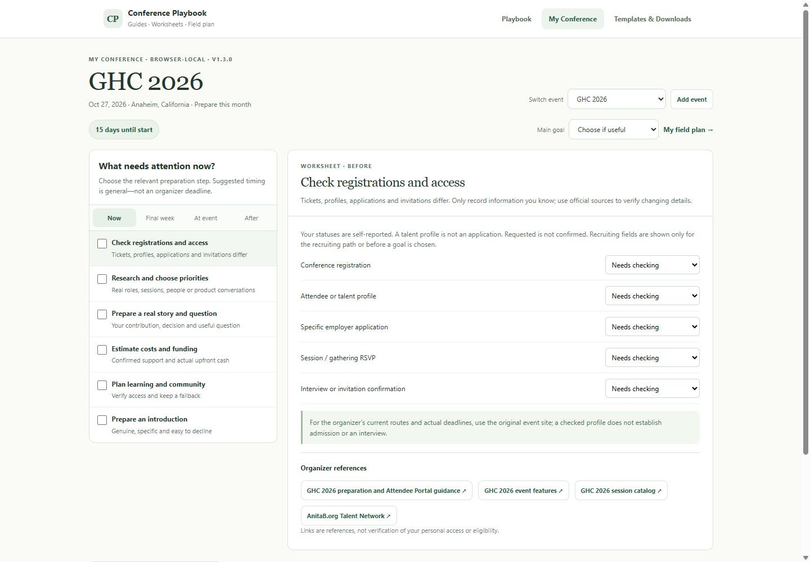 | 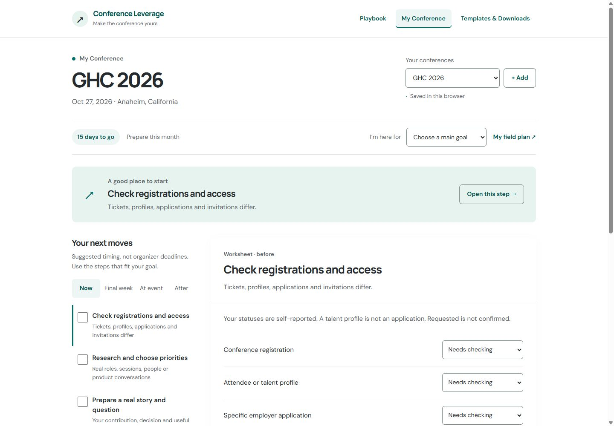 |

| Mobile · before | Mobile · after |
| --- | --- |
| 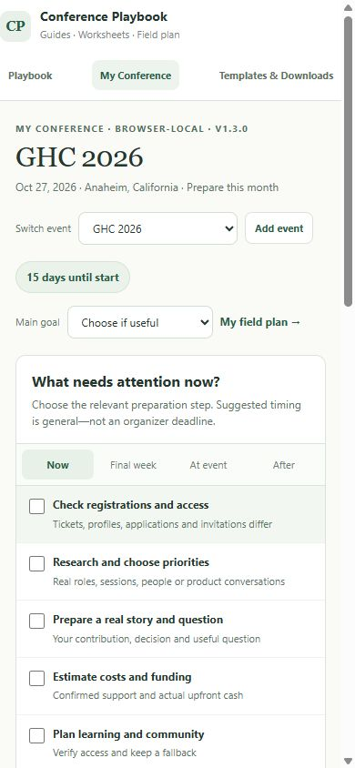 | 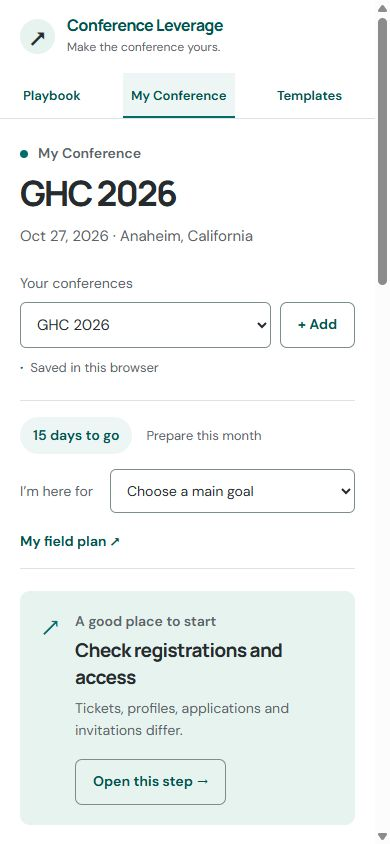 |

## Examples and tools in context

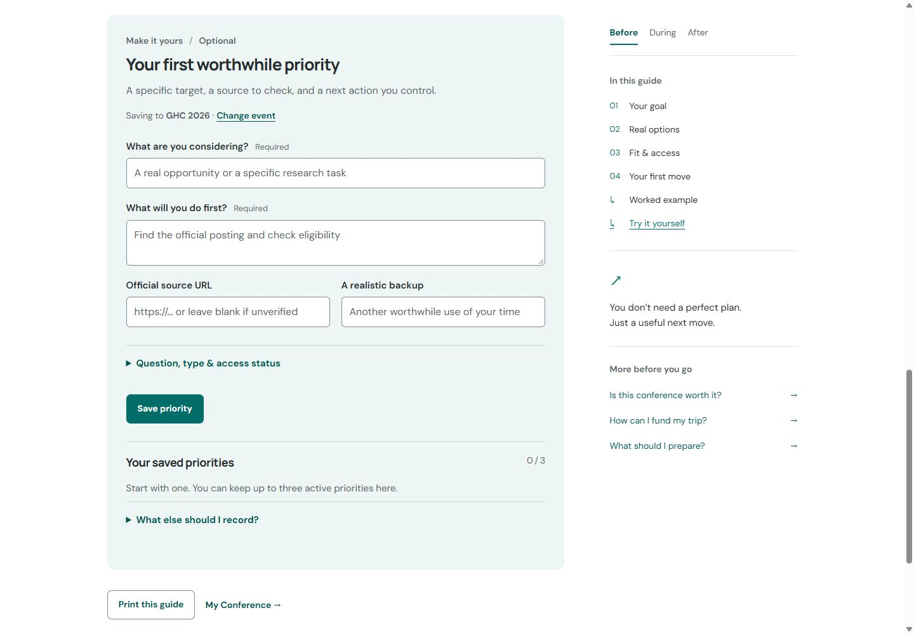

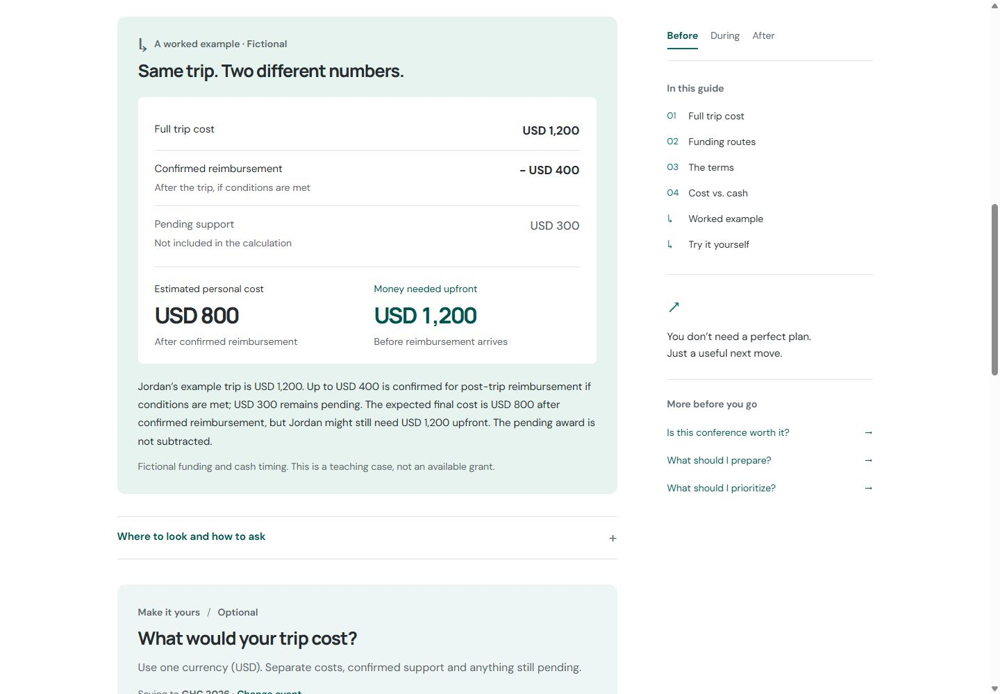

| Mobile funding example | Mobile planner editor |
| --- | --- |
| 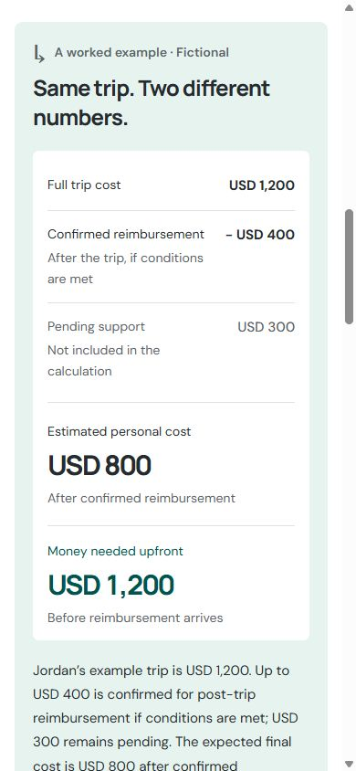 | 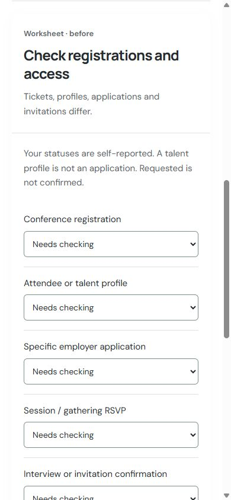 |

## Review focus

Assess the typography, user-selected white/charcoal/teal palette, reading rhythm and connection between the guides and planner. These captures preserve the initial three-experience review. All nine guides, Templates, Field Plan and shared screens use the approved system; see [the rollout gallery](rollout-review.html). Workbook assets and shared build/source checks are now included. Full assistive-technology/browser print QA and source freshness remain release work.
