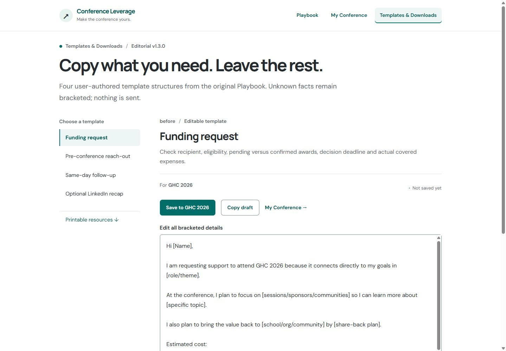

# Conference Leverage · approved design rollout

Internal review, October 13, 2026. After selecting **Charcoal & teal**, the user authorized extending the approved design across the remaining guides and tools. The nine-guide structure, frozen v1.3 content, existing storage and exporter remain in use.

Serve [the interactive rollout gallery](rollout-review.html) to switch between eleven experiences and desktop/phone captures. [The actual app](../index.html?review=full-design#/playbook/before) and [responsive preview](viewport.html?revision=full-design) remain available for interaction. [The initial gallery](REVIEW.md) preserves Priorities, Funding and My Conference before/after views.

## What changed

- All seven remaining guides share numbered advice, a reading rail, approved worked examples, optional detailed instructions, source references and the original planner link or copyable prompt.
- The reading library uses open guide links and a quiet stage bar. Downloads shares the typography and controls.
- All four Templates use a selected navigation rail, event context, a labeled editor, visible local save status and Save/Copy actions above the draft.
- My Field Plan pairs a readable preview with the four existing private-data choices. Each remains excluded by default; the existing exporter supplies the text.

## Matched before/after views

These before views use commit `051f10f`, after the palette selection and before the rollout. Captures are actual Chromium renders using 1,440 × 1,000 px desktop and 390 × 844 px phone viewports. Phone capture rasters are 843–844 px tall. They contain neutral GHC views; functional QA used a separately labeled fictional local event.

| Experience | Desktop before / after | Phone before / after |
| --- | --- | --- |
| Worth guide | [Before](screenshots/rollout-before/worth-desktop.jpg) / [After](screenshots/rollout/worth-desktop.jpg) | [Before](screenshots/rollout-before/worth-mobile.jpg) / [After](screenshots/rollout/worth-mobile.jpg) |
| Templates | [Before](screenshots/rollout-before/templates-desktop.jpg) / [After](screenshots/rollout/templates-desktop.jpg) | [Before](screenshots/rollout-before/templates-mobile.jpg) / [After](screenshots/rollout/templates-mobile.jpg) |
| My Field Plan | [Before](screenshots/rollout-before/field-plan-desktop.jpg) / [After](screenshots/rollout/field-plan-desktop.jpg) | [Before](screenshots/rollout-before/field-plan-mobile.jpg) / [After](screenshots/rollout/field-plan-mobile.jpg) |

## Remaining captured views

| Experience | Desktop | Phone |
| --- | --- | --- |
| Prepare | [Capture](screenshots/rollout/prepare-desktop.jpg) | [Capture](screenshots/rollout/prepare-mobile.jpg) |
| Time | [Capture](screenshots/rollout/time-desktop.jpg) | [Capture](screenshots/rollout/time-mobile.jpg) |
| Conversations | [Capture](screenshots/rollout/conversations-desktop.jpg) | [Capture](screenshots/rollout/conversations-mobile.jpg) |
| Explore | [Capture](screenshots/rollout/explore-desktop.jpg) | [Capture](screenshots/rollout/explore-mobile.jpg) |
| Follow-up | [Capture](screenshots/rollout/followup-desktop.jpg) | [Capture](screenshots/rollout/followup-mobile.jpg) |
| Learning | [Capture](screenshots/rollout/learning-desktop.jpg) | [Capture](screenshots/rollout/learning-mobile.jpg) |
| Reading library | [Capture](screenshots/rollout/playbook-desktop.jpg) | [Capture](screenshots/rollout/playbook-mobile.jpg) |
| Downloads | [Capture](screenshots/rollout/downloads-desktop.jpg) | [Capture](screenshots/rollout/downloads-mobile.jpg) |

## Verification and remaining work

4 Python content checks and 18 Node regression checks pass. Chromium inspected 19 routes at six widths (114 combinations), with no horizontal overflow or duplicate IDs. [Recorded layout results](rollout-viewport-checks.json) include expected headings, template selection, dimensions, font and accent.

UI checks confirmed template save/reload and event separation, excluded-by-default drafts, explicit private-draft inclusion and reset, a long event/save label at 320 px and the Learning guide's planner destination. See [QA evidence and limits](../docs/DESIGN_QA.md) and [shared patterns](../docs/DESIGN_SYSTEM.md).

Workbook/sample PDF assets and generators, editorial synchronization, assistive-technology sessions, production-origin storage checks and Letter/A4 browser print testing remain release work. This rollout stays in draft PR #1 for internal review.
